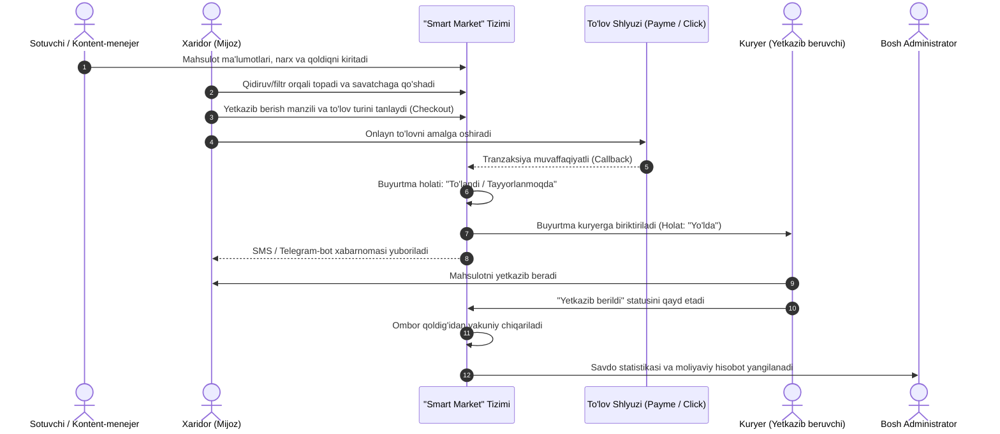

# “Smart Market” — Elektron Savdo (E-commerce) Platformasi

## 1-QADAM. Loyihaning umumiy tavsifi, maqsadi va tizim ishtirokchilari

---

### 1.1. Loyiha pasporti va umumiy ma’lumotlar
- **Loyiha nomi:** “Smart Market” — elektron savdo (E-commerce) platformasi.
- **Loyiha turi:** Veb-platforma (Frontend + Backend + Admin panel) hamda mobil qurilmalarga moslashuvchan (Responsive/PWA yoki API orqali mobil ilovaga ulanadigan) tizim.
- **Qo‘llanilish sohasi:** Chakana va ulgurji onlayn savdo, mahsulotlar katalogini raqamlashtirish, to‘lov va logistika jarayonlarini avtomatlashtirish.

---

### 1.2. Loyihaning maqsadi
Loyihaning asosiy maqsadi — sotuvchilar va xaridorlar o‘rtasida mahsulotlarni internet orqali tezkor, xavfsiz va qulay tarzda sotish hamda xarid qilish imkonini beruvchi yagona raqamli ekotizim yaratishdir. Platforma inson omilini kamaytirish, buyurtmalarni qabul qilishdan tortib yetkazib berishgacha bo‘lgan zanjirni avtomatlashtirish hamda aniq moliyaviy-tahliliy statistika yuritishga xizmat qiladi.

---

### 1.3. Tizimning asosiy vazifalari
Platforma oldiga qo‘yilgan vazifalar 5 ta asosiy yo‘nalishni qamrab oladi:

1. **Mahsulotlar katalogini boshqarish:**
   - Mahsulotlarni ko‘p pog‘onali kategoriyalar, brendlar va xususiyatlar (rang, o‘lcham, og‘irlik, texnik parametrlar) bo‘yicha guruhlash.
   - Aqlli qidiruv (Smart Search), filtrlash va saralash mexanizmlarini taqdim etish.
   - Ombordagi mahsulot qoldig‘ini (Stock) real vaqt rejimida nazorat qilish.

2. **Buyurtmalarni rasmiylashtirish va boshqarish:**
   - Savatcha (Cart), sevimlilar (Wishlist) va bir bosishda xarid qilish (Quick Buy) funksiyalarini ta’minlash.
   - Buyurtma holatlarini (*Yangi*, *To‘lov kutilmoqda*, *Tayyorlanmoqda*, *Yo‘lda*, *Yetkazib berildi*, *Bekor qilindi*) bosqichma-bosqich kuzatish.

3. **Onlayn to‘lovlarni amalga oshirish:**
   - Milliy va xalqaro to‘lov tizimlari (Payme, Click, Uzum Bank, Visa/Mastercard) hamda yetkazib berilganda naqd pul/terminal orqali to‘lash usullarini qo‘llab-quvvatlash.
   - Tranzaksiyalar tarixini saqlash va xarid cheklarini (elektron fiskal kvitansiya) shakllantirish.

4. **Yetkazib berish (Logistika) boshqaruvi:**
   - Yetkazib berish usullarini tanlash (Kuryer orqali manzilgacha, Topshirish punktlari — PVZ, Pochta xizmati).
   - Hudud, masofa yoki buyurtma qiymatiga qarab yetkazib berish narxini avtomatik hisoblash.

5. **Savdo statistikasi va analitika:**
   - Kunlik, haftalik, oylik va yillik savdo aylanmasini vizuallashtirish (grafik va diagrammalarda).
   - Eng ko‘p sotilayotgan mahsulotlar (Top-mahsulotlar), faol mijozlar, o‘rtacha chek miqdori va foyda/xarajat ko‘rsatkichlarini hisoblash hamda Excel/PDF formatida eksport qilish.

---

### 1.4. Tizim foydalanuvchilari (Rollar va huquqlar matritsasi)

| № | Foydalanuvchi roli | Tizimdagi vazifasi va vakolatlari | Kirish interfeysi |
|---|---|---|---|
| **1** | **Mehmon (Ro‘yxatdan o‘tmagan)** | Katalogni ko‘rish, mahsulot qidirish, filtrlash, sharhlarni o‘qish va savatchaga mahsulot qo‘shish. Buyurtma berish uchun avtorizatsiya talab etiladi. | Foydalanuvchi veb-sayti (Frontend) |
| **2** | **Xaridor (Mijoz)** | Shaxsiy kabinetni boshqarish, buyurtma berish, onlayn to‘lov qilish, yetkazib berish manzilini kiritish, buyurtma statusini kuzatish, mahsulotlarga baho va izoh qoldirish. | Foydalanuvchi veb-sayti / Shaxsiy kabinet |
| **3** | **Sotuvchi / Kontent-menejer** | Mahsulot qo‘shish va tahrirlash, narxlar va chegirmalarni belgilash, ombor qoldig‘ini yangilash, kelib tushgan buyurtmalarni qadoqlashga tasdiqlash. | Boshqaruv paneli (Admin/Seller Panel) |
| **4** | **Kuryer (Yetkazib beruvchi)** | O‘ziga biriktirilgan buyurtmalar ro‘yxatini va mijoz manzilini ko‘rish, yetkazib berish statusini (“Qabul qildim”, “Yetkazildi”) yangilash, naqd to‘lov olganlikni tasdiqlash. | Kuryer kabineti (Mobil/Veb interfeys) |
| **5** | **Bosh Administrator (Superadmin)** | Barcha foydalanuvchilar, rollar, kategoriyalar, to‘lov tizimlari sozlamalari, logistika tariflari va to‘liq moliyaviy-savdo statistikasini boshqarish. | To‘liq Boshqaruv paneli (Admin Dashboard) |

---

### 1.5. Tizimning umumiy ishlash ssenariysi (Biznes-jarayon zanjiri)

