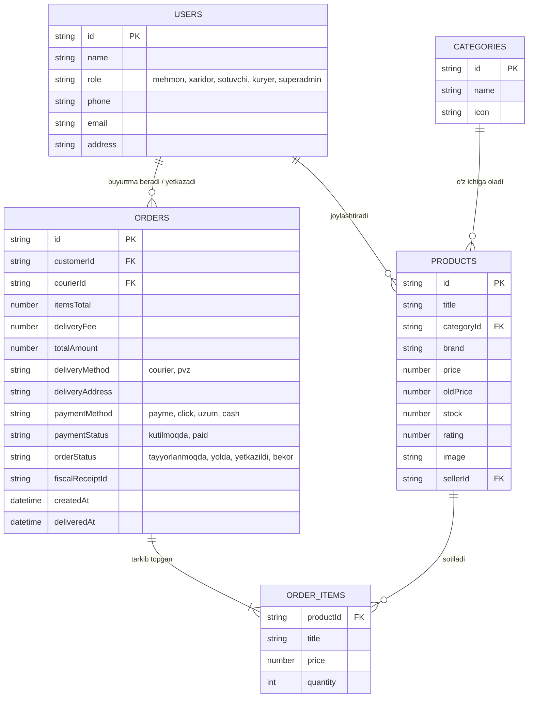

# 2-QADAM. TIZIM ARXITEKTURASI, TEXNOLOGIYALAR STEKI VA MA'LUMOTLAR MODELI

---

### 2.1. Tanlangan texnologiyalar steki (Technology Stack)

1. **Backend (Server & API):**
   - **Muhit:** Node.js (v26 LTS)
   - **Freymvork:** Express.js (RESTful API arxitekturasi)
   - **Xavfsizlik:** CORS himoyasi, Role-based Access Control (RBAC)
   - **Ma'lumotlar boshqaruvi:** Tranzaksion JSON Data Store (Prisma / PostgreSQL ga to'liq moslashtirilgan struktura)

2. **Frontend & Admin Panellar:**
   - **Dizayn & Uslublar:** Tailwind CSS (Modern, mobile-responsive grid, flexbox tizimi)
   - **Interaktivlik & Logika:** Asinxron JavaScript (Fetch API, SPA rejimida barcha 5 ta rolni boshqarish)
   - **Vizualizatsiya & Grafika:** Chart.js (Savdo dinamikasi, mahsulot toifalari tahlili)
   - **Ikonkalar:** FontAwesome 6 Pro SVG to'plami

3. **To'lov va Logistika Integratsiyasi:**
   - Payme, Click va Uzum Bank test/webhook shlyuzlari
   - Avtomatik fiskal kvitansiya (QR / Chek identifikatori) yaratish generatori
   - PVZ (Topshirish punktlari) va Kuryer narxini avtomatik hisoblagich

---

### 2.2. Ma'lumotlar bazasining relyatsion tuzilmasi (ER Model)



---

### 2.3. REST API Endpointlar Ro'yxati

| Metod | Endpoint | Ruxsat etilgan rol | Vazifasi |
|---|---|---|---|
| `GET` | `/api/health` | Barchaga | Tizim holati (Healthcheck) |
| `GET` | `/api/products` | Barchaga | Filtrlash, qidiruv va saralash bilan tovarlar ro'yxati |
| `GET` | `/api/products/:id` | Barchaga | Tovarning batafsil kartochkasi |
| `POST` | `/api/products` | Sotuvchi, Superadmin | Yangi tovar qo'shish |
| `PUT` | `/api/products/:id` | Sotuvchi, Superadmin | Tovarni tahrirlash yoki ombor zaxirasini to'ldirish |
| `DELETE`| `/api/products/:id` | Sotuvchi, Superadmin | Tovarni o'chirish |
| `GET` | `/api/orders` | Barchaga | Buyurtmalar ro'yxati (filtrlash bilan) |
| `POST` | `/api/orders` | Xaridor, Mehmon | Savatchadagi tovarlarga buyurtma berish & to'lov |
| `PATCH`| `/api/orders/:id/status` | Sotuvchi, Kuryer, Admin | Buyurtma statusini yangilash ("Yo'lda", "Yetkazildi") |
| `GET` | `/api/analytics` | Superadmin | Moliyaviy ko'rsatkichlar, grafiklar va Top-5 tovarlar |
| `GET` | `/api/settings` | Barchaga | Yetkazib berish tariflari va to'lov tizimlari sozlamalari |

---

### 2.4. Ishga tushirish bo'yicha ko'rsatma

1. Bog'liqliklarni o'rnatish:
   ```bash
   npm install
   ```
2. Loyihani ishga tushirish:
   ```bash
   npm start
   ```
3. Brauzerda ochish:
   ```
   http://localhost:3000
   ```
Yuqori o'ng paneldagi **Rol tanlagich** orqali istalgan 5 ta rolga o'tish va to'liq biznes jarayonni sinab ko'rish mumkin.

