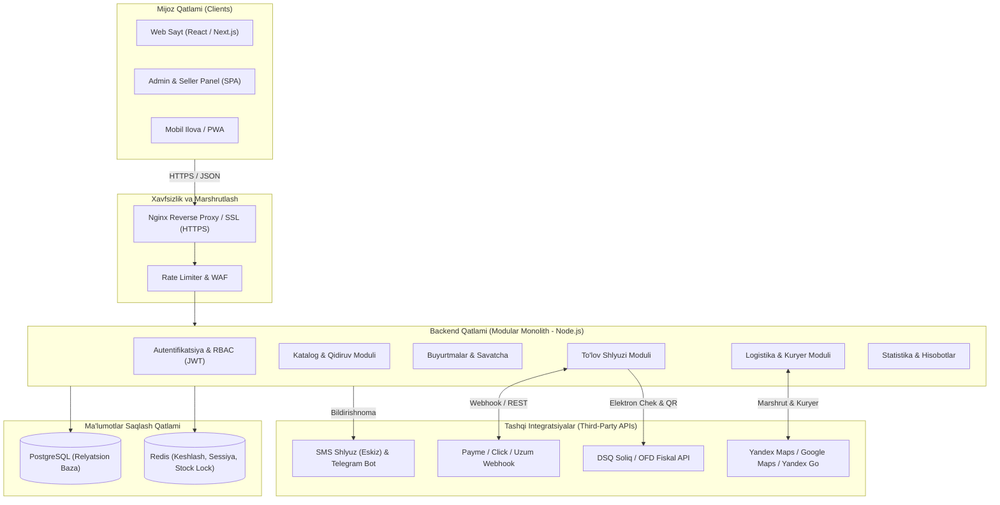

# 4-QADAM. TIZIM ARXITEKTURASI, TEXNOLOGIK STEK, INTEGRATSIYALAR VA XAVFSIZLIK TALABLARI

“Smart Market” platformasining barqaror, xavfsiz va yuqori yuklamalarga chidamli (scalable) ishlashini ta’minlash uchun tizim arxitekturasi va texnik talablari quyidagicha belgilanadi.

---

### 4.1. Tizim arxitekturasi (System Architecture)

Platforma zamonaviy **Mijoz-Server (Client-Server) va Mikroxizmatlarga moslashuvchan Monolit (Modular Monolith)** arxitekturasi asosida quriladi. Bu boshlang‘ich bosqichda tizimni tez ishga tushirish va kelgusida yuklama oshganda uni alohida mikroservislarga (katalog, buyurtma, logistika) bo‘lish imkonini beradi.

- **Frontend (Mijoz qismi):**
  - Foydalanuvchi veb-sayti va Admin panel — Single Page Application (SPA) yoki Server-Side Rendering (SSR) yondashuvi.
  - Mobil qurilmalar uchun moslashuvchan (Responsive Web Design) dizayn.
- **Backend (Server qismi):**
  - RESTful API va GraphQL arxitekturasi asosida ishlovchi server dasturi. Frontend va mobil ilovalar server bilan JSON formatida muloqot qiladi.
- **Ma’lumotlar bazasi va Keshlash (Database & Caching):**
  - Asosiy ma’lumotlar uchun Relyatsion baza (**PostgreSQL**).
  - Tezkor qidiruv, savatcha va seanslarni boshqarish hamda ma’lumotlarni keshlash uchun **Redis** xotirasi.

---

### 4.2. Texnologik stek (Technology Stack)

Loyiha uchun tanlangan optimal texnologiyalar ro‘yxati:

| Yo‘nalish / Qatlam | Tanlangan texnologiya / Framework | Sababi va vazifasi |
|---|---|---|
| **Frontend (Web)** | React.js / Next.js yoki Vue.js / Nuxt.js | Tezkor interfeys, SEO optimizatsiyasi va qulay komponentlar tizimi. |
| **Backend** | Node.js (Express / NestJS) yoki Python (FastAPI) | Asinxron so‘rovlarni yuqori tezlikda qayta ishlash, REST API yaratish qulayligi. |
| **Ma’lumotlar bazasi** | PostgreSQL | Ishonchli, transaksiyalarni (ACID) to‘liq qo‘llab-quvvatlaydigan relyatsion baza. |
| **Keshlash & Navbat** | Redis | Tezkor ma’lumot almashish, ombor rezervatsiyasi va sessiyalarni saqlash. |
| **Server & DevOps** | Docker, Nginx, Linux (Ubuntu) | Dasturiy ta’minotni konteynerlash, xavfsiz va barqaror server muhiti. |

---

### 4.3. Tashqi integratsiyalar (Third-Party Integrations)

Tizimning funksionalligini kengaytirish uchun quyidagi tashqi xizmatlar bilan API orqali bog‘lanish ta’minlanadi:

1. **To‘lov tizimlari:**
   - **Payme API / Click API / Uzum Bank API:** Onlayn to‘lovlarni qabul qilish va webhook orqali tranzaksiya statusini tasdiqlash.
2. **Logistika va Xarita xizmatlari:**
   - **Yandex Maps / Google Maps API:** Yetkazib berish manzilini aniqlash, kuryer uchun marshrut tuzish va masofani hisoblash.
   - **Yandex Go Delivery API:** Shahar ichida tezkor ekspress yetkazib berishni avtomatlashtirish.
3. **Bildirishnoma va Xabarnomalar:**
   - **SMS Shlyuz (Eskiz / PlayMobile):** Mijozlarga tasdiqlash kodlari va buyurtma statusi haqida SMS yuborish.
   - **Telegram Bot API:** Adminlar va kuryerlar uchun yangi buyurtmalar haqida tezkor bildirishnomalar yuborish.
4. **Soliq va Fiskalizatsiya:**
   - **DSQ (Soliq qo‘mitasi) / OFD API:** Har bir onlayn xarid uchun avtomatik ravishda fiskal chek va QR-kod generatsiya qilish.

---

### 4.4. Axborot xavfsizligi va Ma’lumotlarni himoya qilish talablari

Platformada foydalanuvchilarning shaxsiy ma’lumotlari va moliyaviy tranzaksiyalarining xavfsizligi qat’iy ta’minlanishi kerak:

- **Shifrlash (Encryption):**
  - Sayt va server o‘rtasidagi barcha ma’lumotlar **HTTPS (SSL/TLS sertifikati)** protokoli orqali shifrlangan holda uzatiladi.
  - Foydalanuvchi parollari bazada ochiq holda saqlanmaydi; ular **Argon2** yoki **Bcrypt** algoritmida xeshlanadi (hash).
- **Autentifikatsiya va Avtorizatsiya:**
  - Foydalanuvchi sessiyalari xavfsiz **JWT (JSON Web Token)** yoki o‘chish vaqti cheklangan Access/Refresh tokenlar orqali boshqariladi.
  - Admin va sotuvchi panellariga kirish uchun majburiy ikki bosqichli autentifikatsiya (2FA) yoki IP-manzil cheklovi joriy etiladi.
- **Hujumdan himoya (Security Measures):**
  - **SQL Injection va XSS himoyasi:** Barcha kiruvchi ma’lumotlarni (Inputs) qat’iy sanitariya va validatsiyadan o‘tkazish.
  - **Rate Limiting:** Bir IP-manzildan qisqa vaqt ichida juda ko‘p so‘rov kelishining oldini olish (DDoS va brute-force hujumlaridan himoya qilish uchun).
- **Zaxira nusxalash (Backup):**
  - Ma’lumotlar bazasining avtomatik zaxira nusxalari (Daily Backup) har kuni shifrlangan holda bulutli xotiraga saqlab boriladi.

