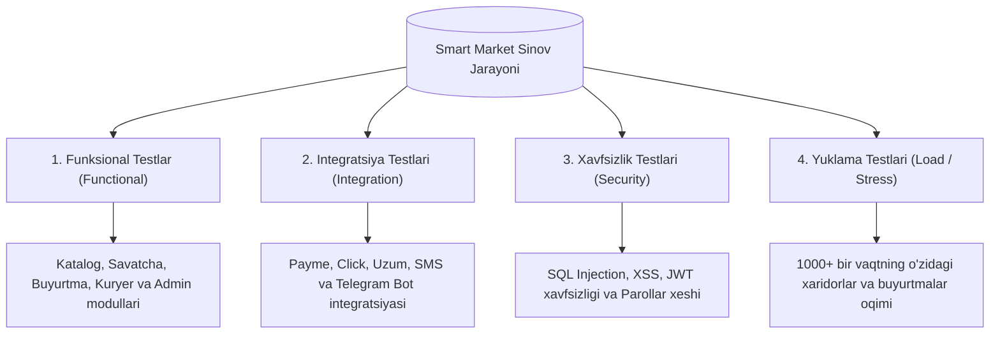
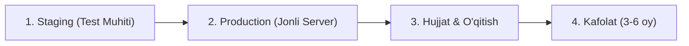

# 5-QADAM. INTERFEYS (UI/UX) TALABLARI, SINOVDAN O‘TKAZISH VA TOPSHIRISH TARTIBI

“Smart Market” platformasining foydalanuvchi interfeysiga qo‘yiladigan talablar, uni test qilish bosqichlari va loyihani buyurtmachiga topshirish tartibi quyidagicha belgilanadi:

---

### 5.1. Foydalanuvchi interfeysi (UI/UX) talablari

* **Responsivlik (Moslashuvchanlik):**
  - Veb-sayt barcha qurilmalarda (Smartfon, Planshet, Noutbuk va Katta monitorlar) birdek mukammal ishlaydigan **Mobile-First** (mobil qurilmalarga ustuvor qaratilgan) dizayn tamoyili asosida yaratiladi.
* **Dizayn va Ranglar palitrasi:**
  - Brend identiteti va elektron tijorat qoidalariga mos ravishda ko‘zni charchatmaydigan yorqin va qulay ranglar (masalan, asosiy rang — ishonchli yashil `#16a34a` / to‘q firuza, urg‘u uchun — to‘q sariq `#f59e0b` va qizil `#ef4444` ranglar) tanlanadi.
  - Qorong‘i (Dark Mode) va yorug‘ (Light Mode) rejimlarni qo‘llab-quvvatlash.
* **Tezkorlik va Foydalanish qulayligi (Usability):**
  - Sahifaning yuklanish vaqti (Load time) 2 sekunddan oshmasligi kerak.
  - Xarid qilish zanjiri (Checkout) imkon qadar qisqa bo‘lishi (maksimal 2–3 qadamda yakunlanishi) ta’minlanadi.

---

### 5.2. Sinovdan o‘tkazish (Testing) turlari

Loyiha ishga tushishidan oldin quyidagi test sinovlaridan o‘tkaziladi:

1. **Funksional testlar (Functional Testing):**
   - Barcha modullar (katalog, savatcha, buyurtma berish, to‘lov va kuryer paneli) talablarga qat'iy muvofiqligi tekshiriladi.
2. **Integratsiya testlari (Integration Testing):**
   - Tashqi to‘lov tizimlari (Payme/Click) va SMS/Telegram shlyuzlari bilan ma’lumot almashinuvi xatosiz ishlashi tekshiriladi.
3. **Xavfsizlik testlari (Security Testing):**
   - Saytning SQL Injection, XSS hujumlariga bardoshliligi va parollarning xeshlanishi tekshiriladi.
4. **Yuklama testi (Load / Stress Testing):**
   - Bir vaqtning o‘zida yuzlab foydalanuvchilar saytga kirib buyurtma berganda serverning barqaror ishlashi tekshiriladi.

---

### 5.3. Loyihani topshirish tartibi (Delivery & Deployment)

Loyiha quyidagi bosqichlar orqali rasman topshiriladi:

1. **Test muhitida (Staging) namoyish etish:**
   - Tizim vaqtincha test serverga o‘rnatilib, buyurtmachiga to‘liq ko‘rsatiladi va kamchiliklar aniqlansa bartaraf etiladi.
2. **Ishlab chiqarish muhitiga o‘tkazish (Production):**
   - Dasturiy ta’minot real Domen va VPS/Cloud serverga joylashtiriladi, SSL sertifikat o‘rnatiladi.
3. **Hujjatlashtirish va O‘qitish:**
   - Adminlar va xodimlar uchun tizimdan foydalanish bo‘yicha qo‘llanma (Instruction manual) taqdim etiladi va qisqa trening o‘tkaziladi.
4. **Kafolat davri (Warranty):**
   - Tizim topshirilgandan keyin **3–6 oy davomida** aniqlangan texnik xatolar bepul tuzatib berish kafolati taqdim etiladi.

